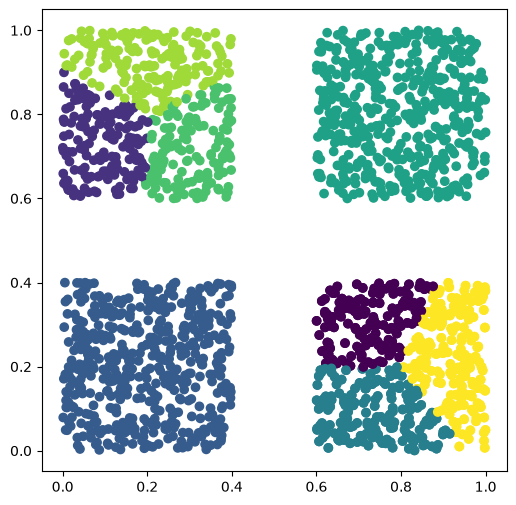
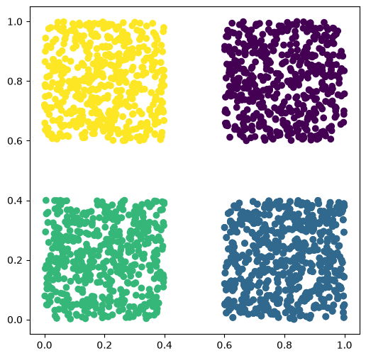
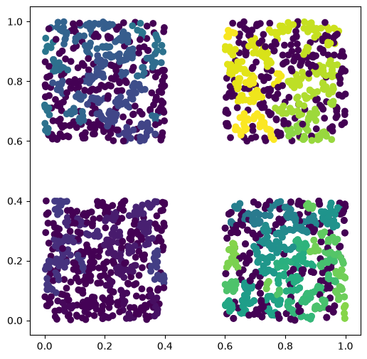
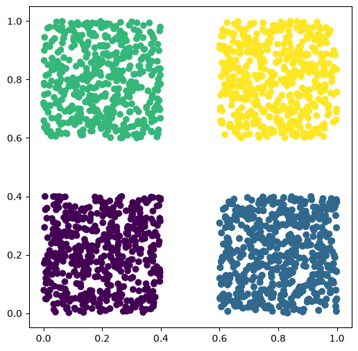

# Cluster


<!-- WARNING: THIS FILE WAS AUTOGENERATED! DO NOT EDIT! -->

------------------------------------------------------------------------

### data_points

``` python
def data_points(
    n, min_x:int=0, min_y:int=0, max_x:int=1, max_y:int=1, seed:NoneType=None
):
```

*Una clase que contiene a los datos*

``` python
clase_puntos.get_Multypoint()
```


## Clusters

A partir de la clase data_point podemos generar muchos puntos y queremos
hacer un agrupamiento de dichos puntos

------------------------------------------------------------------------

### Clusters

``` python
def Clusters(
    data_points_i, seed:int=1234
):
```

*Clase para generar los clusters a partir de un objeto de la clase
data_points*

Esta clase se utiliza para generar los distintos tipos de
clusterizaciones, se almacena los datos en una estructura de datos y se
le añaden las respectivas classes

------------------------------------------------------------------------

### Clusters.DBSCAN

``` python
def DBSCAN(
    **kwargs
):
```

*Se DBSCAN para la obtencion de clusters, las clases quedan almacenadas*
en .data_structure_classes_DBSCAN. Si se desea obtener el modelo se
tiene que añadir (ret_model = True) como parámetro.

------------------------------------------------------------------------

### Clusters.KMeans

``` python
def KMeans(
    **kwargs
):
```

*Se usa el algoritmo Kmeans para la obtencion de clusters, * las clases
quedan almacenadas en .data_structure_classes_Kmeans. Si se desea
obtener el modelo se tiene que añadir (ret_model = True) como parámetro.

------------------------------------------------------------------------

### Clusters.HDBSCAN

``` python
def HDBSCAN(
    **kwargs
):
```

*Se HDBSCAN para la obtencion de clusters, las clases quedan
almacenadas* en .data_structure_classes_HDBSCAN. Si se desea obtener el
modelo se tiene que añadir (ret_model = True) como parámetro.

------------------------------------------------------------------------

### Clusters.OPTICS

``` python
def OPTICS(
    **kwargs
):
```

*Se usa el algoritmo OPTICS para la obtencion de clusters, * las clases
quedan almacenadas en .data_structure_classes_OPTICS. Si se desea
obtener el modelo se tiene que añadir (ret_model = True) como parámetro.

``` python
datos_simples_3 = data_points(500, min_x = 0.6, min_y= 0.6, max_x= 1.0, max_y= 1.0 )
datos_simples_2 = data_points(500, min_x = 0.0, min_y= 0.6, max_x= 0.4, max_y= 1.0 )
```

``` python
datos_simples_1 = data_points(500, min_x = 0.6, min_y= 0.0, max_x= 1.0, max_y= 0.4 )
datos_simples_0 = data_points(500, min_x = 0.0, min_y= 0.0, max_x= 0.4, max_y= 0.4 )
datos_simples_0.add_points(datos_simples_1)
```

``` python
datos_simples_0.get_Multypoint()
```


``` python
datos_simples_0.get_Multypoint()
```


``` python
datos_simples_0.add_points(datos_simples_1)
datos_simples_0.add_points(datos_simples_2)
datos_simples_0.add_points(datos_simples_3)
```

Vamos a utilizar nuestra clase clusters para ver como los distintos
algoritmos hacen una clusterización

``` python
cluster_all  = Clusters(datos_simples_0)
```

``` python
cluster_all.OPTICS()
```

``` python
cluster_all.HDBSCAN()
```

    /home/miguel/conda_previus/envs/nbdev_2026_t/lib/python3.13/site-packages/sklearn/cluster/_hdbscan/hdbscan.py:722: FutureWarning: The default value of `copy` will change from False to True in 1.10. Explicitly set a value for `copy` to silence this warning.
      warn(

``` python
cluster_all.DBSCAN(eps=0.1, min_samples=10)
```

``` python
cluster_all.KMeans()
```

# Kmeans

``` python
fig, ax = plt.subplots(1, 1, figsize=(6, 6))

plt.scatter(
cluster_all.data_structure.get_X(),
cluster_all.data_structure.get_Y(),
c=cluster_all.data_structure.classes_Kmeans
)
```



Veamos en cuantas clases se agruparon

``` python
np.unique(cluster_all.data_structure.classes_Kmeans)
```

    array([0, 1, 2, 3, 4, 5, 6, 7], dtype=int32)

``` python
np.unique(cluster_all.data_structure.classes_DBSCAN)
```

    array([0, 1, 2, 3])

``` python
np.unique(cluster_all.data_structure.classes_OPTICS)
```

    array([ -1,   0,   1,   2,   3,   4,   5,   6,   7,   8,   9,  10,  11,
            12,  13,  14,  15,  16,  17,  18,  19,  20,  21,  22,  23,  24,
            25,  26,  27,  28,  29,  30,  31,  32,  33,  34,  35,  36,  37,
            38,  39,  40,  41,  42,  43,  44,  45,  46,  47,  48,  49,  50,
            51,  52,  53,  54,  55,  56,  57,  58,  59,  60,  61,  62,  63,
            64,  65,  66,  67,  68,  69,  70,  71,  72,  73,  74,  75,  76,
            77,  78,  79,  80,  81,  82,  83,  84,  85,  86,  87,  88,  89,
            90,  91,  92,  93,  94,  95,  96,  97,  98,  99, 100, 101, 102,
           103, 104, 105, 106, 107, 108, 109, 110, 111, 112, 113, 114, 115,
           116, 117, 118, 119, 120, 121, 122, 123, 124, 125, 126, 127, 128,
           129, 130, 131, 132, 133, 134, 135, 136, 137, 138, 139, 140, 141,
           142, 143, 144, 145, 146, 147, 148, 149, 150, 151, 152, 153, 154,
           155, 156, 157, 158, 159, 160, 161, 162, 163, 164, 165, 166, 167,
           168, 169, 170, 171, 172, 173, 174, 175, 176, 177, 178, 179, 180,
           181, 182])

``` python
np.unique(cluster_all.data_structure.classes_HDBSCAN)
```

    array([0, 1, 2, 3])

# HDBSCAN

``` python
fig, ax = plt.subplots(1, 1, figsize=(6, 6))

plt.scatter(
cluster_all.data_structure.get_X(),
cluster_all.data_structure.get_Y(),
c=cluster_all.data_structure.classes_HDBSCAN
)
```



# OPTICS

``` python
fig, ax = plt.subplots(1, 1, figsize=(6, 6))

plt.scatter(
cluster_all.data_structure.get_X(),
cluster_all.data_structure.get_Y(),
c=cluster_all.data_structure.classes_OPTICS
)
```



``` python
fig, ax = plt.subplots(1, 1, figsize=(6, 6))

plt.scatter(
cluster_all.data_structure.get_X(),
cluster_all.data_structure.get_Y(),
c=cluster_all.data_structure.classes_DBSCAN
)
```


